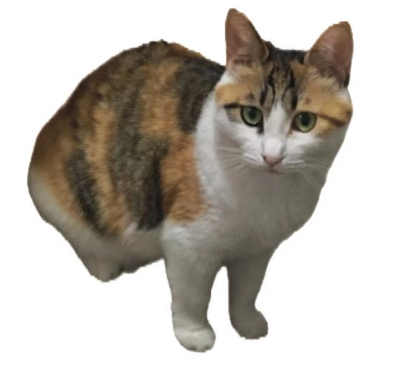
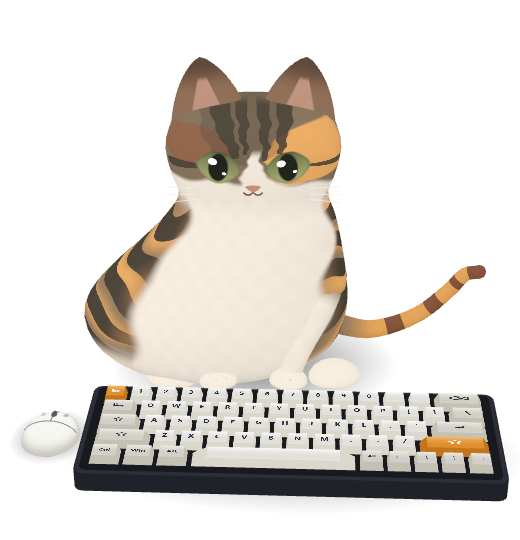

# KuroCat 妙妙版

妙妙版是 [@lr-2211](https://github.com/lr-2211) 基于开源桌宠 KuroCat 制作的非官方定制版。

## 原作者与上游

**KuroCat 原作者及维护者为 [Kevin Hao（@qianyiai）](https://github.com/qianyiai)。** 原始项目、原有功能与桌宠动画系统来自 [qianyiai/kurocat](https://github.com/qianyiai/kurocat) 及其贡献者。

- [上游源代码](https://github.com/qianyiai/kurocat) · [上游官网](https://qianyi.one/kurocat/)
- 本版基于 [上游 v5.1.2](https://github.com/qianyiai/kurocat/releases/tag/v5.1.2) 的提交 [`7ef3211`](https://github.com/qianyiai/kurocat/commit/7ef32111e357db6ea6d96c196353bc49512221f6)。
- [上游 README](README.upstream.zh-CN.md) · [English](README.en.md) · [日本語](README.ja.md)
- 沿用 [MIT 许可证](LICENSE)，保留原有版权及第三方署名。内置「大肥鱼」素材源自 [PC2005-cloud/dsh-pet](https://github.com/PC2005-cloud/dsh-pet)，参考 [QCYTSN/dsh-dafeiyu](https://github.com/QCYTSN/dsh-dafeiyu)。详见[素材许可证](src/assets/dafeiyu/LICENSE-MIT.txt)。

## 彩狸猫妙妙

| 妙妙原照 | 妙妙的 3D 桌宠形象 |
| :---: | :---: |
|  |  |

## 妙妙版的改动

- 新增 3D「妙妙」。根据妙妙的照片设计了专属轮廓、橄榄绿眼睛、左右不对称的棕色与金橙色脸斑、橙棕环纹尾巴，并修整了左眼下方的斑块。
- 妙妙沿用 KuroCat 的 3D 动作，包括双爪敲键、握鼠标、尾巴拍键、眯眼、睡醒与防窥闭眼。
- 新增妙妙的摸头反应。前三秒保留原有的享受表情和呼噜，连续抚摸满三秒会生气并朝指针方向咬一下。每段连续抚摸触发一次，停手或移开指针后重新计时。
- 全新配置首次启动默认显示 3D 妙妙。已有配置中的角色选择会保留。

## Windows 安装与构建

Windows 10 / 11 x64 安装包见 [Releases](https://github.com/lr-2211/Kurocat-miaomiao/releases)。本分支的安装与动作验证以 Windows x64 为准。其他平台的安装方式见[上游说明](README.upstream.zh-CN.md)。

本地构建需要 Node.js、Rust 与 [Tauri 的 Windows 构建依赖](https://v2.tauri.app/start/prerequisites/)。在仓库根目录运行：

```powershell
npm ci
npm run tauri -- build --bundles nsis
```

生成的安装程序位于 `src-tauri/target/release/bundle/nsis/`。
